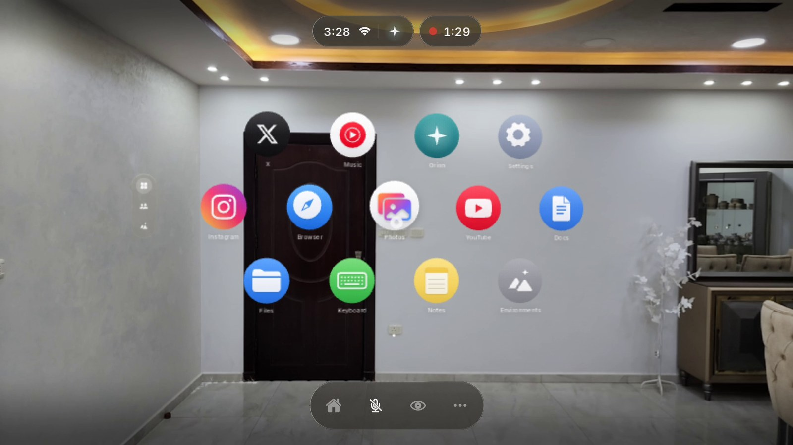
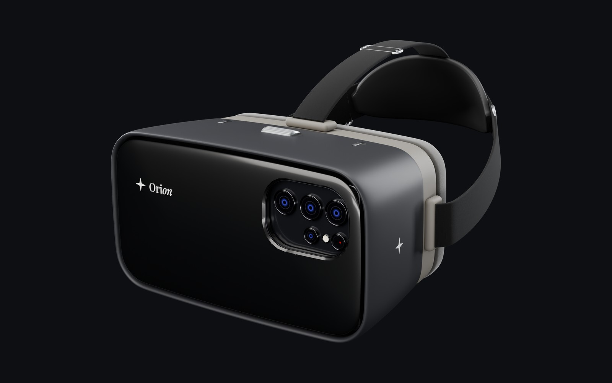

# Orion Vision OS

Orion Vision OS turns the Android phone you already have into a mixed reality headset. The phone goes into a cheap
phone VR viewer, its back camera shows you the room, and windows float in that room: a browser, YouTube, settings and
more. You move them with your hands and you talk to Orion, the voice assistant, to open, close and search.

This is the project from my video. It is an early alpha: it works on my phone, it gets hot, and a lot is still
changing. The code is not published yet. This repo has what you need to know today, the supported phones, how the
system works and the models behind it, and it is where the code and the models will land.

- [How it works](docs/HOW_IT_WORKS.md): every layer, with pictures
- [The models](docs/MODELS.md): what runs on the phone, the data, the numbers and the graphs
- [Supported phones](SUPPORTED_DEVICES.md): the full list by brand and model

## What you need

1. **A phone.** It runs the whole system: the cameras, the motion sensors, the screen, the processor and the AI models
   are already in it. See [supported phones](#supported-phones).
2. **A phone VR viewer.** Any one works if its front leaves the back cameras of the phone uncovered, because the system
   has to see the room. They start at about 15 USD. Mine is a VR Shinecon that cost about 25 USD. I am designing our
   own 3D-printed viewer; until it is done, use any viewer you have.
3. **A Fish Audio account.** You create an API key for the voice assistant. Orion speaks with Fish Audio's Live 3
   Duplex model, which listens while it talks, so you can interrupt it or stop to think and it follows you.
   You also need an API key from any AI provider you like (ChatGPT, Claude or another one).

## AR, VR, MR

- **AR, augmented reality:** you see the real world as it is, with digital things added on top. Camera filters and
  Pokemon GO are AR.
- **VR, virtual reality:** you see no real world at all. Everything in front of you is made.
- **MR, mixed reality:** the two together. From VR we take the viewer that covers your eyes and gives each eye its own
  picture. From AR we take the real world staying in view. And the digital things behave like real objects: open a
  window, put it somewhere, turn your head or walk, and it stays exactly where you left it. You can grab it, move it
  and resize it.
- **XR, extended reality:** one name for all three.

## How it works

The system is a stack of layers.

| Layer | What it does |
|---|---|
| Camera | The phone sits in the viewer with its back camera uncovered. The camera picture goes straight to the screen, so you wear the viewer and still see the room. This is called passthrough. |
| One picture per eye | The screen is split in two, one half per eye, and each half is bent on purpose so the lenses of the viewer bend it back into a normal picture. |
| Tracking | ARCore, Google's AR library for Android, looks at the camera picture and the motion sensors and works out where the phone is in the room and where it points. Not only turning your head: walking forward and back too. |
| Windows | The windows are drawn over the camera picture. Each one has a saved place in the room, and the system keeps working out where to draw it from where your head is. |
| Smoothness | The last picture is turned with your head from the motion sensor, even if the rest of the system is a little late, so the view does not lag behind your head. |
| Hands | The same camera sees your hands. The system finds your fingers, and a pinch is a click: scroll, open apps, grab windows. |
| Voice | Say "Orion" and ask: open an app, close everything on the screen, search for something. |

Every layer in more detail, with pictures: [docs/HOW_IT_WORKS.md](docs/HOW_IT_WORKS.md).

## Supported phones

Windows that stay in place need ARCore, and ARCore does not run on every Android phone. Google keeps an official list
of certified devices, with phones from Samsung (the S and Note lines and part of the A line), Google Pixel, Xiaomi,
OnePlus and many others. The phone also needs Google services, because ARCore is installed from Google Play as
"Google Play Services for AR".

- The full list, by brand and model: [SUPPORTED_DEVICES.md](SUPPORTED_DEVICES.md)
- Tested by me so far: **Samsung Galaxy S22 Ultra (Snapdragon)**. The alpha is only offered for phones I have really
  tried.
- **No ARCore on your phone?** The system should still run, but the windows follow your head instead of staying in the
  room.

## The models

| Job | Model | Notes |
|---|---|---|
| Hands | MediaPipe hand landmarks (Google) | 21 points per hand; from them the system knows when you pinch |
| Voice assistant | Fish Audio Live 3 Duplex | needs your own API key |
| Wake word "Orion" | my own model | small, always on, runs on the phone; trained on speech I generated with the Fish Audio API in many accents and languages, plus normal speech and noise it must ignore |
| Hands, next version | my own models | in training, not in the app yet |

The data, the numbers and the graphs for each model: [docs/MODELS.md](docs/MODELS.md).

The models I trained will be published on Hugging Face when their training is finished.

## Status

- Early alpha, not a stable release, and a stable one is not close.
- The phone gets hot. Several AI models and the camera run at the same time, and my phone (the Snapdragon S22 Ultra)
  is known for heat. Making the system lighter is most of the work that is left.
- To try the alpha you need a phone from the tested list, a Fish Audio API key and an API key from an AI provider.

## What is coming

- The source code, here, when the first version is ready.
- The trained models on Hugging Face.
- Our own 3D-printed viewer. This is the design:

  

- More tested phones.

Follow this repo to know when the code lands.

## Credits

- Voice: [Fish Audio](https://fish.audio/?fpr=ipdev) Live 3 Duplex
- Tracking: [ARCore](https://developers.google.com/ar) by Google
- Hands: [MediaPipe](https://developers.google.com/mediapipe) by Google
