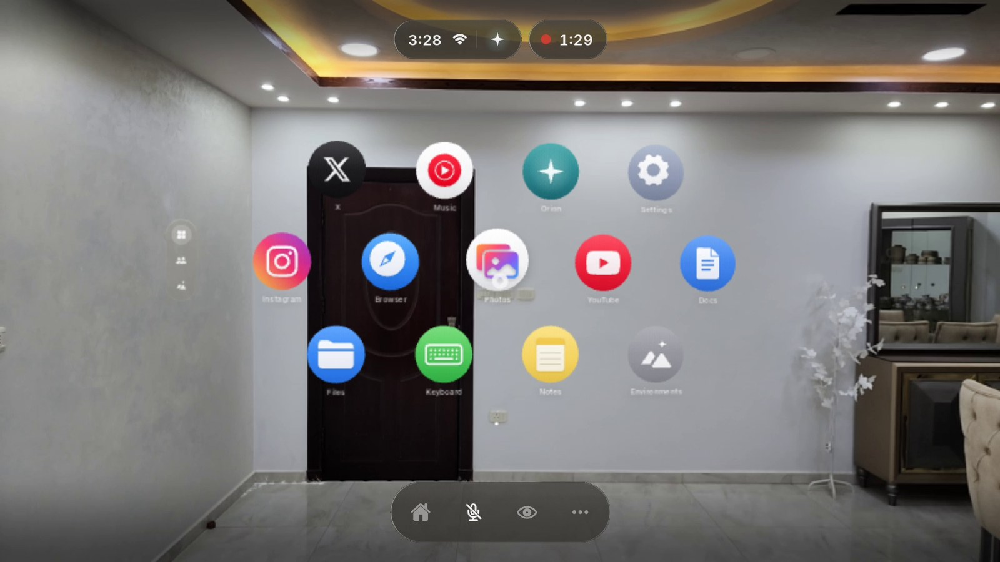
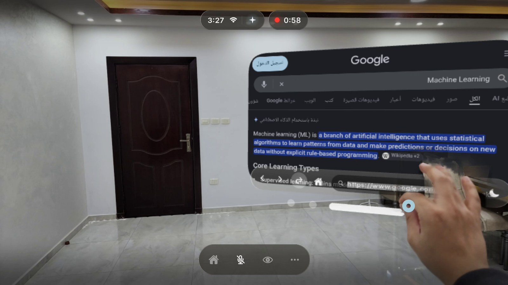
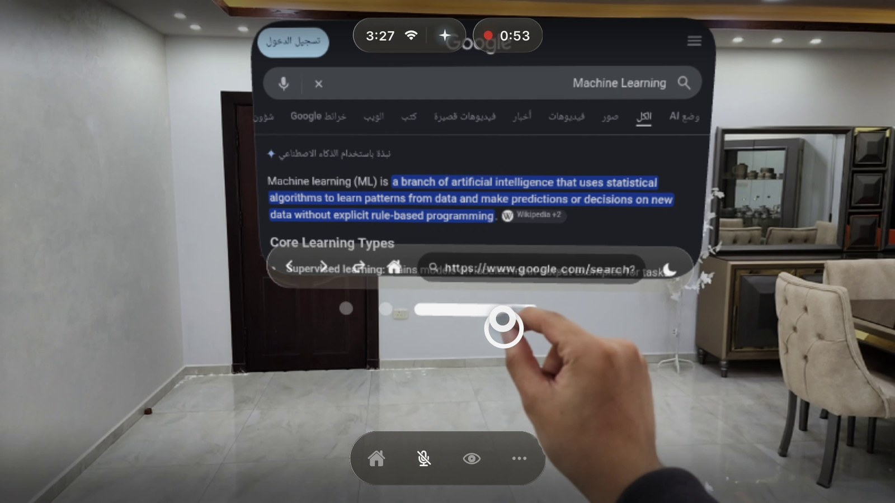

# How Orion Vision OS works

Everything runs on the phone. There is no PC, no cable and no extra sensor. The phone sits in a phone VR viewer with
its back cameras uncovered, and the system is a stack of layers on top of the camera picture.

## 1. The camera: you still see your room

The back camera of the phone is drawn straight to the screen. You wear the viewer and you still see the room in front
of you. This is called passthrough. Everything else is drawn on top of this picture.

## 2. One picture per eye

The screen is split in two halves, one for each eye, the way every phone VR viewer expects. The lenses of a viewer
bend the picture, so each half is bent the opposite way first. Through the lenses it comes out straight again.

## 3. Where your head is

To keep a window in one place in the room, the system has to know where the phone is and where it points, many times
a second. That is the job of ARCore, Google's AR library for Android. It looks at the camera picture and at the motion
sensors of the phone, finds points in the room it can follow, and works out the position of the phone:

- turning your head left, right, up and down,
- and also moving: forward, back, sideways, up and down.

Together that is called 6DoF tracking. ARCore only runs on phones Google has certified, which is why there is a
[list of supported phones](../SUPPORTED_DEVICES.md). On a phone without ARCore the system only knows how the head
turns (3DoF), so windows follow your head instead of staying in the room.

## 4. Windows that stay where you put them

Every window has a saved place in the room. For every frame the system takes the position of your head from the
tracking layer and works out where that window has to be drawn in each eye. Turn your head or walk away and the window
stays on its wall. You can grab the bar under a window to move it, and resize it.

## 5. No lag behind your head

Drawing a full frame takes time, and a picture that arrives late feels like the room is swimming. So right before a
frame is shown, the last finished picture is turned once more with the newest reading of the motion sensor. Even when
the rest of the system is a little late, the view follows your head.

## 6. Hands

The same camera that shows you the room sees your hands. A hand model finds 21 points on each hand (the joints and the
fingertips). From the distance between the tip of the thumb and the tip of the index finger the system knows when you
pinch:

- a pinch is a click,
- a pinch that moves is a drag or a scroll,
- a pinch on the bar under a window grabs it.

Today the hand points come from Google's MediaPipe Hand Landmarker. My own hand models are in training, see
[the models](MODELS.md).

## 7. Voice

A very small model listens all the time for one word, "Orion". It runs on the phone and nothing leaves the phone
while it waits. When it hears the word, the assistant starts listening. There are two modes:

| Mode | How it works | Good for |
|---|---|---|
| Classic | Your speech becomes text, a language model decides what to do, the reply becomes speech. | Commands: open an app, close everything, search. |
| Live | Fish Audio's Live 3 Duplex model listens while it talks. You can interrupt it, or stop to think, and it follows. | Talking with the assistant like with a person in the room. |

The voice assistant needs your own API keys: a Fish Audio key for the voice, and a key from an AI provider.

## What a phone needs

These are the planned minimums. They can still change before the first public version.

| | Minimum |
|---|---|
| Android | 10 or newer, 64-bit ARM |
| Graphics | OpenGL ES 3.1 |
| Sensors | gyroscope |
| Camera | 1080p at 30 frames per second |
| Memory | 6 GB RAM |
| For windows that stay in the room | ARCore (Google Play Services for AR) |

## Heat, the real limit today

The camera, the tracking, the hand model and the voice models all run at the same time on one phone. On my phone, a
Samsung Galaxy S22 Ultra with the Snapdragon 8 Gen 1, every session reaches the "severe" heat state after about one
and a half to three minutes, and the phone then slows itself down. Making every layer lighter is most of the work that
is left before a stable version.
