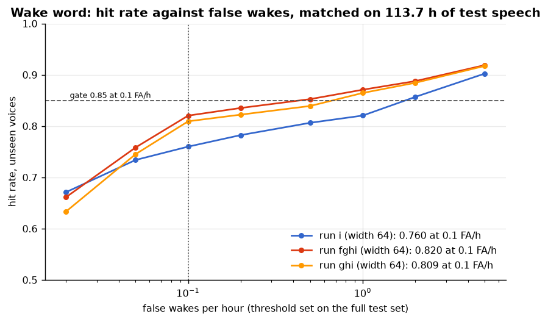
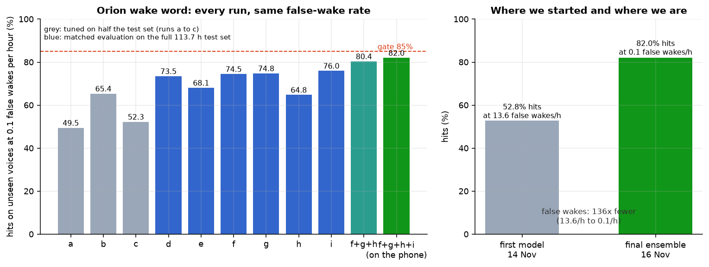
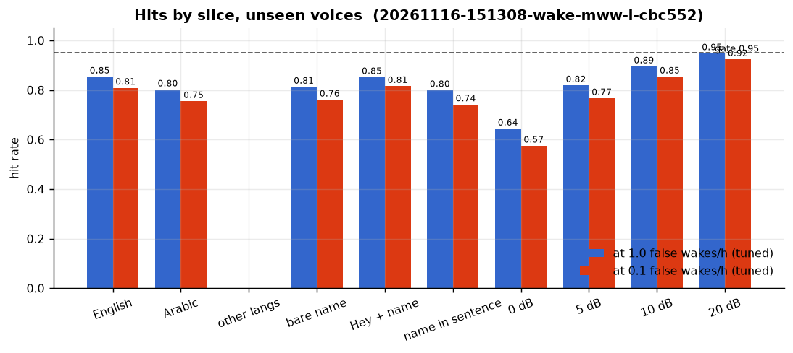
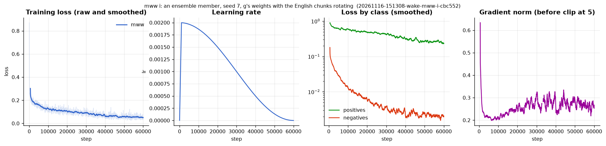
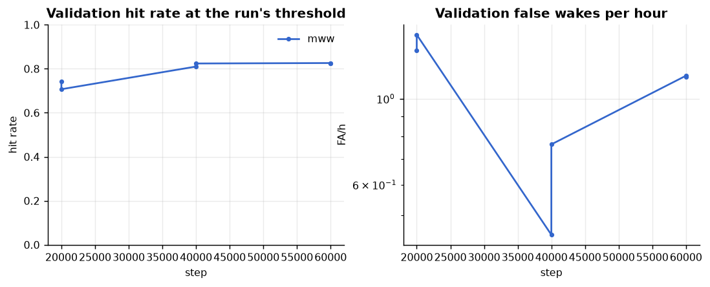
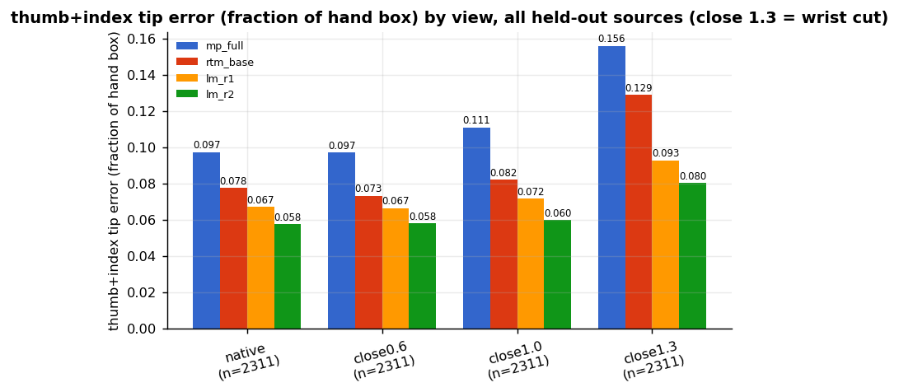
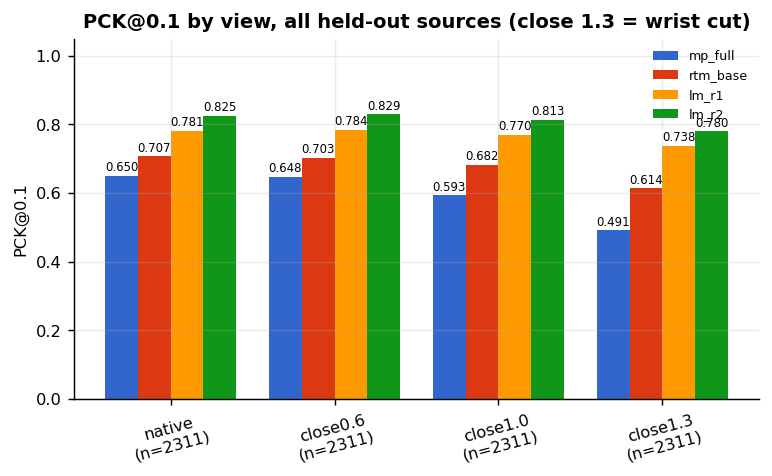
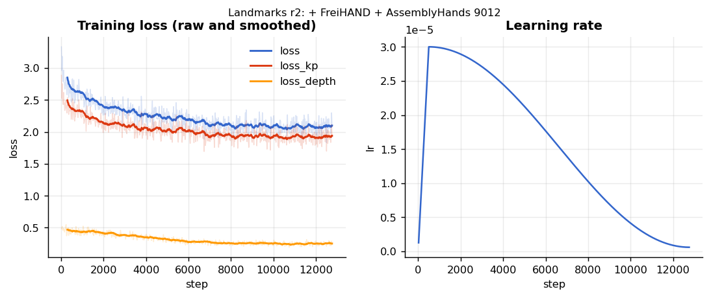
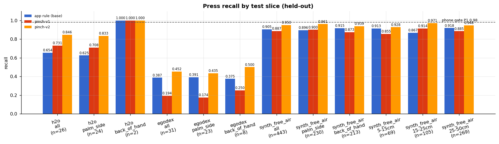
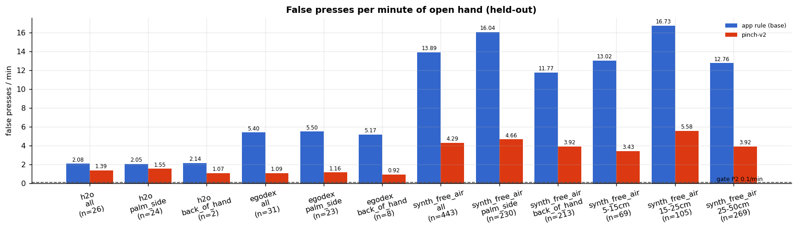

# The models

Each model in Orion Vision OS has one small job. Some are ready-made, some I trained myself. All numbers on this page
are measured on data the models never saw in training.

| Job | Model | In the app today |
|---|---|---|
| Wake word "Orion" | my own model | yes |
| Hand points | Google MediaPipe Hand Landmarker | yes |
| Hand points, next version | my own model | no, in training |
| Pinch | a rule on the hand points; my own model in training | the rule |
| Voice assistant | Fish Audio Live 3 Duplex | yes, with your own API key |

## Wake word: "Orion"

There is no ready-made model that knows this word, so I trained one from zero.

**What it is**

- A small 1D ResNet in the microWakeWord style. The shipped model is four training runs working together.
- 893,377 parameters per run, 3.57 million in total, 14.3 MB as an ONNX file.
- It hears a window of 1.5 seconds of sound at 16 kHz, turned into 40 frequency bands.
- It runs on the phone with ONNX Runtime on one CPU thread and gives a score every 100 milliseconds.

**The data**

The positive clips are generated speech. I used the Fish Audio API to say "Orion" in thousands of voices:

- 127,815 generated clips from 4,129 voices in 12 languages. Arabic 39.6 %, English 22.8 %, French 9.0 %, then
  Turkish, Persian, Spanish, Urdu, Hindi, German, Russian, Indonesian and Malay.
- Arabic in four dialect groups: Levantine, Gulf, Egyptian and Maghrebi.
- Three ways of saying it: the name alone, the name after a lead word ("Hey Orion"), and the name inside a sentence.
- Different styles: calling across the room, whispering, fast, sleepy.
- Every clip was listened to by Whisper. A clip where the word was not heard correctly was generated again.

The model also has to learn what is NOT the word:

- words that sound close to "Orion",
- ordinary words, and the same sentences with another name in place of "Orion",
- 82 hours of real public speech (Common Voice English and Arabic, MASC, LibriSpeech, SADA),
- 21 hours of noise and music (FSD50K, WHAM, ESC-50, MUSAN, DEMAND).

The final model is trained on English and Arabic, with 119,032 generated clips.

**The result**

Tested on 113.7 hours of speech the model never heard: 16,422 clips, 13,076 of them with the word, all from voices
that are not in the training data.

| False wakes per hour | Wake words caught |
|---|---|
| 0.02 | 66.2 % |
| 0.05 | 75.8 % |
| **0.1** | **82.0 %** |
| 0.2 | 83.5 % |
| 0.5 | 85.3 % |
| 1 | 87.1 % |
| 5 | 91.9 % |

At the setting used on the phone (about one false wake in ten hours):

| | Caught |
|---|---|
| English | 84.8 % |
| Arabic | 79.5 % |
| Quiet room (20 dB above the noise) | 94.5 % |
| Noisy (10 dB) | 89.3 % |
| Very noisy (5 dB) | 81.1 % |
| Noise as loud as the voice (0 dB) | 62.9 % |

My target was 85 % at 0.1 false wakes per hour. The model is at 82.0 %, so it is not there yet.

The first model, two days before the final one, caught 52.8 % with 13.6 false wakes per hour. The final one catches
82.0 % with 0.1 false wakes per hour: 136 times fewer false wakes.

## Hands

**In the app today:** Google's MediaPipe Hand Landmarker. It gives 21 points for each hand, and a rule on the distance
between the thumb tip and the index tip decides when you pinch.

**In training:** my own model for the 21 points, built for this one use: hands seen from a camera on your face, often
with the wrist outside the picture. It is a fine-tuned RTMPose-m model.

Measured against MediaPipe (the full model) on public test sets that neither model was trained on (H2O, InterHand,
AssemblyHands and EgoDex, 2,311 hands for each view):

| | MediaPipe full | My model |
|---|---|---|
| Points within 10 % of the hand size (PCK@0.1) | 0.650 | 0.825 |
| Thumb tip and index tip error, as a part of the hand size | 0.097 | 0.058 |
| Same, when the wrist is cut off by the edge of the picture | 0.156 | 0.080 |
| Points within 10 %, wrist cut off | 0.491 | 0.780 |

The fingertip error is 40 % smaller, and 49 % smaller when the wrist is cut off. The fingertips are what a pinch is
made of, so this is the number that matters most here.

What is not good yet, and why it is not in the app:

- It is bigger and slower than MediaPipe today: 13.8 million parameters against 2.7 million. Making it lighter than
  Google's model is the goal, not the state today.
- On whole hands, a few points (the wrist and two index finger joints) are worse than MediaPipe.

**Pinch model, in training:** a very small model (43 thousand parameters) that looks at the hand points over time
instead of one frame.

It catches more pinches than the rule and presses by mistake less often, but it does not reach my targets yet (98 %
of pinches caught, at most 0.1 false presses per minute).

## Voice assistant

Orion speaks with [Fish Audio](https://fish.audio/?fpr=ipdev)'s Live 3 Duplex model. This one is not mine: you use it
with your own Fish Audio API key. It listens while it talks, so you can interrupt it or stop to think.

## Where the models will be

The models I trained will be published on Hugging Face when their training is finished. This page will get the links.
